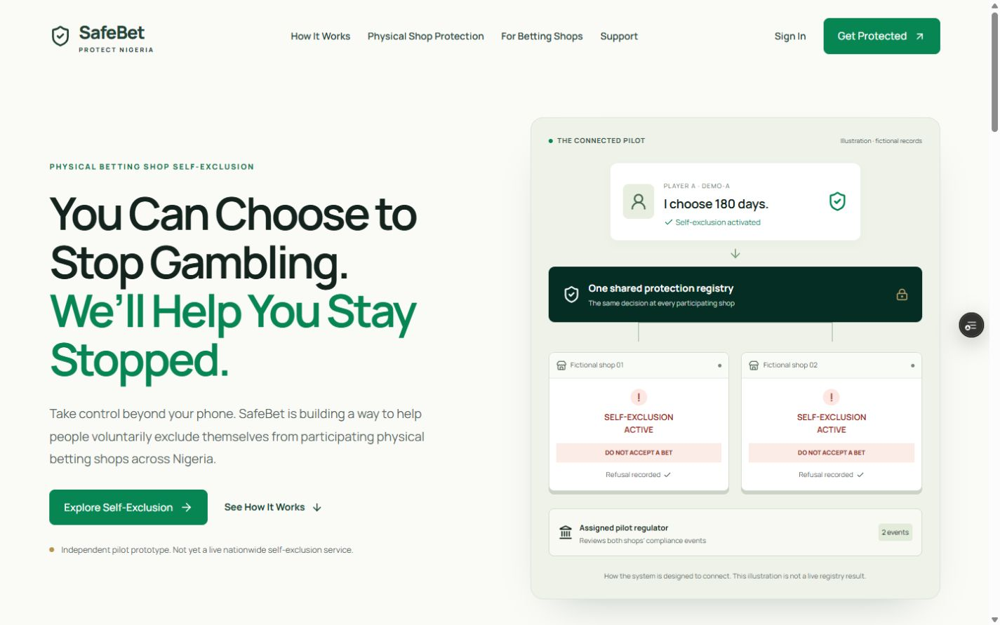

# Preview verification — 9–10 November 2026

Preview: https://safebet-protect-git-feat-prote-42988a-michealshoe2000s-projects.vercel.app

The deployed revision 522952c was tested in a real connected browser. The public desktop homepage rendered at 1440×900; mobile rendered at 390×844 without horizontal overflow (content and viewport client width both 375 pixels). Navigation to How It Works worked. The anonymous nine-question assessment completed using synthetic “Not at all” responses. Unauthenticated protected navigation showed a sign-in prompt and no private workspace records.

Public reporting showed an unavailable-service error and could not submit; no successful hosted report is claimed. Subsequent read-only inspection found migration 002 absent and IDENTITY_LOOKUP_PEPPER missing from Vercel's variable list. See REDESIGN-AUDIT.md. The follow-up change adds classified reporting failures and request references, and uses the public layout for signed-out workspace prompts. These follow-up changes require deployment to repeat their browser check.

Local validation: 22 automated tests, TypeScript and Next build passed. ESLint exits successfully with 120 existing/retained warnings, primarily explicit-any in legacy modules; this is not a warning-free codebase. The connected multi-shop test uses PGlite PostgreSQL and mocked authentication, not the hosted database.

Still outstanding: hosted six-digit email delivery and session persistence, player activation, two staff sessions against an isolated demo project, jurisdiction review, hosted anonymous report tracking, private evidence storage, offline/reconnect walkthrough and full keyboard/screen-reader audit. Keep PR #3 draft until external acceptance is complete.
